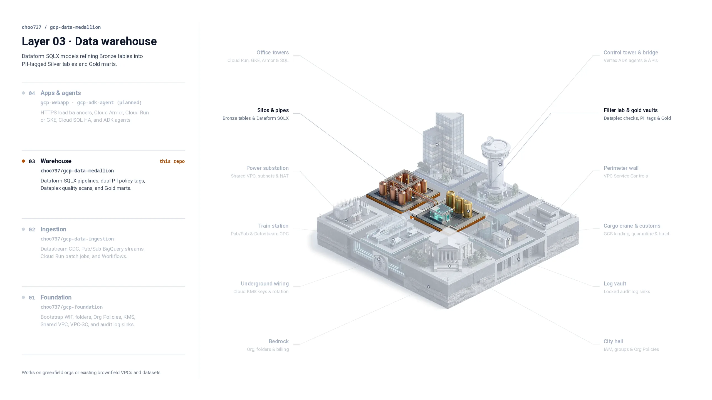
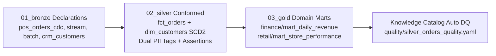

[00 Launchpad](https://github.com/choo737/gcp-launchpad) · [01 Foundation](https://github.com/choo737/gcp-foundation) · [02 Ingestion](https://github.com/choo737/gcp-data-ingestion) · **03 Medallion** · [04 Data Science](https://github.com/choo737/gcp-data-science)

# GCP Data Medallion

Dataform `3.1.5` SQLX models for Bronze, Silver, and Gold BigQuery warehouses across `dev`, `uat`, and `prod`.
Works with [gcp-launchpad](https://github.com/choo737/gcp-launchpad) or standalone against existing BigQuery Bronze tables.



## Quick Orientation

Transform raw Bronze tables into PII-tagged Silver records, Gold domain marts, and Knowledge Catalog quality scans.

| Consumes From | Deploys | Hands Off To | Standalone Ready? |
| --- | --- | --- | --- |
| `gcp-data-ingestion` Bronze tables or existing BigQuery Bronze | Dataform `3.1.5` SQLX (`01_bronze`, `02_silver`, `03_gold`) and Knowledge Catalog DQ | `gcp-data-science`, Data Studio, and Finance or Retail marts | Yes (adapt `definitions/01_bronze/*.sqlx` declarations) |

## Start in 3 Steps

1. **Create your private repository** (GitHub forces standard forks of public repos to stay public):

```bash
gh repo create example-org/gcp-data-medallion --private --template choo737/gcp-data-medallion --clone
cd gcp-data-medallion
gh repo view --json isPrivate --jq '.isPrivate'
```

Confirm `gh repo view` prints `true` before saving `envs/{dev,uat,prod}.compilation.json`.

2. **Run with your AI coding agent** (`Claude Code`, `OpenAI Codex`, `Gemini CLI`, or `Antigravity`):

```text
Read AGENTS.md, QUESTIONNAIRE.md, and .agents/skills/setup-data-medallion/SKILL.md.
Check optional platform-context.json, populate envs/{dev,uat,prod}.compilation.json, and run make test.
```

3. **Verify locally**:

```bash
make help
make test
```

## Platform Districts

| Repository | District & Layer | Core Capabilities | Status |
| --- | --- | --- | --- |
| [gcp-launchpad](https://github.com/choo737/gcp-launchpad) | `00` City Planning Hub | Intake Q&A, preflight check, and Brownfield bridge | Active |
| [gcp-foundation](https://github.com/choo737/gcp-foundation) | `01` Governance & Utilities | Folders, 38 Org Policies, Shared VPC, VPC-SC, KMS, and SCC | Active |
| [gcp-data-ingestion](https://github.com/choo737/gcp-data-ingestion) | `02` Entry Ports & Bridges | Pub/Sub + DLQ, Datastream CDC, Cloud Run jobs, and Workflows | Active |
| **gcp-data-medallion** *(this repo)* | `03` Warehouses & Quality | BigQuery Bronze/Silver/Gold, Dataform, and Knowledge Catalog | Active |
| [gcp-data-science](https://github.com/choo737/gcp-data-science) | `04` Offices, AI & Homes | Agent Platform, BigQuery ML, TreeSHAP XAI, and WORM ledger | Active |
| `gcp-webapp` *(Planned)* | Hosted App Template | HTTPS Load Balancer, Cloud Armor, Cloud Run, and Cloud SQL | Roadmap |
| `gcp-adk-agent` *(Planned)* | Hosted Agent Template | Google ADK on Agent Runtime or Cloud Run with eval gates | Roadmap |

## Technical Reference

<details open>
<summary><strong>1. Architecture, Mermaid Flow & 2026 Product Naming</strong></summary>

Dataform `3.1.5` compiles `workflow_settings.yaml` without `package.json` to link `01_bronze`, `02_silver`, and `03_gold` layers.



- **Dataform `3.1.5` Native Execution**: Uses `workflow_settings.yaml` at `/` with no `package.json` or separate dbt runtime.
- **Dual BigQuery Policy Tags**: Attaches `pii_restricted_policy_tag` and `pii_masked_policy_tag` via `includes/policy_tags.js` (`allow_untagged_pii: "false"` in `prod`).
- **Aligned CDC Lookback**: Keeps `updatePartitionFilter` and incremental `WHERE` equal via `cdc_lookback_days` (`1..3650`).
- **SCD Type 2 Deduplication**: Strips unchanged heartbeats with `scd_type2.scd2PreviousHashSql` before computing `valid_from`, `valid_to`, and `is_current`.
- **2026 data names**: Uses Knowledge Catalog (formerly Dataplex) and BigQuery Policy Tags (formerly Data Catalog).
- **2026 BI names**: Uses Data Studio (formerly Looker Studio) on Gold domain marts.

Read [docs/01-architecture-and-sqlx-reference.md](docs/01-architecture-and-sqlx-reference.md) for all 18 contract variables, helper internals, and Bronze rules.

</details>

<details open>
<summary><strong>2. Prerequisites, Keyless WIF CI/CD & Cost Guardrails</strong></summary>

Three GitHub Actions workflows enforce SQLX hygiene, keyless Dataform compilation, and tag-gated production promotion over WIF.

- `.github/workflows/ci.yml`: Validates `workflow_settings.yaml`, Node.js helpers, and `tests/test_medallion_integrity.py` on every push.
- `.github/workflows/dataform-dryrun.yml`: Runs hermetic tests and Dataform GA `v1` `compilationResults` on PRs.
- `.github/workflows/dataform-promote.yml`: Updates `dev-main` and `uat-main` on `main`, and `prod-main` on `v*` tags.

| GitHub Variable | Example Value | Purpose |
| --- | --- | --- |
| `GCP_WIF_PROVIDER` | `projects/<num>/locations/global/workloadIdentityPools/gh/providers/repo` | Workload Identity Pool provider path |
| `GCP_WIF_SERVICE_ACCOUNT` | `dataform-ci@example-silver-project.iam.gserviceaccount.com` | Service account granted Dataform roles |
| `DATAFORM_REPO_PATH` | `projects/example-silver-project/locations/asia-southeast1/repositories/medallion` | Target Dataform repository resource name |
| `PII_MASKED_POLICY_TAG` | `projects/<gov>/locations/<loc>/taxonomies/111/policyTags/222` | Masked PII Policy Tag path |
| `PII_RESTRICTED_POLICY_TAG` | `projects/<gov>/locations/<loc>/taxonomies/111/policyTags/333` | Restricted PII Policy Tag path |

- **Zero-idle serverless baseline**: BigQuery on-demand SQLX queries cost `$0/mo` idle when no `prod` slots are reserved.
- **Optional slot commitment**: Enabling `100` baseline slots in `asia-southeast1` via `gcp-foundation` adds `$5,365.50/mo` PAYG.

</details>

<details open>
<summary><strong>3. Repository Layout, Agent Skills & Day-0 to Day-2 Guides</strong></summary>

### Antigravity or OpenAI Codex

```text
Read AGENTS.md, QUESTIONNAIRE.md, and .agents/skills/setup-data-medallion/SKILL.md.
Check gitignored platform-context.json, fill envs/{dev,uat,prod}.compilation.json, and run make test.
```

### Claude Code

```text
Read CLAUDE.md, AGENTS.md, and QUESTIONNAIRE.md.
Follow .agents/skills/setup-data-medallion/SKILL.md for envs/{dev,uat,prod}.compilation.json without package.json, then run make test.
```

| Skill | File | Purpose |
| --- | --- | --- |
| `setup-data-medallion` | `.agents/skills/setup-data-medallion/SKILL.md` | Interactive onboarding via `QUESTIONNAIRE.md` and `platform-context.json` |
| `add-medallion-model` | `.agents/skills/add-medallion-model/SKILL.md` | Add a Bronze declaration, Silver table, and Gold mart |
| `split-domain-mesh` | `.agents/skills/split-domain-mesh/SKILL.md` | Split a Gold domain folder into another repository |

### Repository Layout

- `workflow_settings.yaml` & `envs/`: Dataform `3.1.5` root config (`18` `vars`, no `package.json`) and env examples.
- `definitions/01_bronze/`: Raw CDC, stream, batch, and `ml_xai_audit_ledger` `declaration` files (no DDL).
- `definitions/02_silver/`: Conformed `fct_orders`, `dim_customers`, `ml_customer_features`, dual Policy Tags, and assertions.
- `definitions/03_gold/`: Incremental domain marts under `finance/`, `retail/`, and `mlops/`.
- `includes/` & `quality/`: JavaScript SQLX helpers and Knowledge Catalog Auto data quality specs.
- `QUESTIONNAIRE.md`, `CODEOWNERS`, `assets/`, `docs/`, & `tests/`: Intake, path reviewers, diagrams, guides, and integrity tests.

### Day-0 to Day-2 Guides & Sibling Playbooks

- [Medallion Onboarding Questionnaire](QUESTIONNAIRE.md)
- [Architecture and Dataform SQLX Reference](docs/01-architecture-and-sqlx-reference.md)
- [Enterprise Medallion Operationalization Guide](docs/02-enterprise-operationalization-guide.md)
- [GCP Launchpad (Suite Hub & Brownfield Bridge)](https://github.com/choo737/gcp-launchpad)
- [GCP Foundation (Landing Zone & Dataform Terraform)](https://github.com/choo737/gcp-foundation)
- [GCP Data Ingestion (Datastream, Pub/Sub & Batch ELT)](https://github.com/choo737/gcp-data-ingestion)
- [GCP Data Medallion (GitHub Template)](https://github.com/choo737/gcp-data-medallion)
- [GCP Data Science (Feature Store, BQML & TreeSHAP XAI)](https://github.com/choo737/gcp-data-science)

</details>

## License

Apache License 2.0. See [LICENSE](LICENSE).

**Disclaimer:** This is a personal project. The views, code, and opinions expressed are my own and do not represent my current or past employers.
