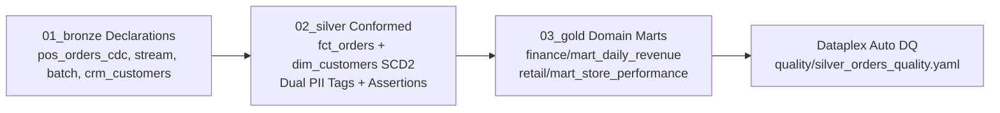

# GCP Data Medallion

BigQuery Dataform `3.1.5` SQLX models for Bronze, Silver, and Gold medallion warehouses across `dev`, `staging`, and `prod`.

This repository belongs to the [gcp-launchpad](https://github.com/choo737/gcp-launchpad) Google Cloud template suite.

## Template Suite Overview

Start in [gcp-launchpad](https://github.com/choo737/gcp-launchpad) for multi-repo routing, or use this repository standalone against existing BigQuery Bronze tables.

| Repository | Role | Scope | Status |
| :--- | :--- | :--- | :--- |
| [gcp-launchpad](https://github.com/choo737/gcp-launchpad) | Entry Hub & Router | Suite Overview, Architecture Router, and Brownfield Bridge (`platform-context.json`) | Active |
| [gcp-foundation](https://github.com/choo737/gcp-foundation) | Platform & Governance | Org guardrails, projects, KMS, datasets, Policy Tags, and Dataform repositories | Active |
| [gcp-data-ingestion](https://github.com/choo737/gcp-data-ingestion) | Bronze Ingestion | Datastream CDC, Pub/Sub streaming, Cloud Run batch ELT, and Cloud Workflows | Active |
| **[gcp-data-medallion](https://github.com/choo737/gcp-data-medallion)** *(this repo)* | Warehouse & Quality | Dataform `3.1.5` SQLX Medallion (`01_bronze` -> `02_silver` -> `03_gold`) and Dataplex DQ | Active |
| `gcp-webapp` | Application Layer | HA Cloud Run web portal with External HTTPS Load Balancer and Cloud SQL | Planned |
| `gcp-adk-agent` | AI Agent Layer | Production Google ADK agent on Vertex AI Agent Engine or Cloud Run | Planned |

## Create Your Private Repository (Do Not Fork Publicly)

GitHub forces normal forks of public repositories to stay public.

Click **Use this template** on GitHub or run this command:

```bash
gh repo create acme-corp/gcp-data-medallion --private --template choo737/gcp-data-medallion --clone
```

## Architecture & Capabilities

Dataform `3.1.5` compiles `workflow_settings.yaml` without `package.json` to link `01_bronze` declarations, `02_silver` models, and `03_gold` marts.



- **Dataform `3.1.5` Native Execution**: Uses `workflow_settings.yaml` at `/` with no `package.json` and zero separate dbt runtime cost.
- **Dual PII Policy Tags**: Enforces `pii_restricted_policy_tag` and `pii_masked_policy_tag` via `includes/policy_tags.js` (`allow_untagged_pii: "false"` in `staging`/`prod`).
- **Aligned CDC Lookback**: Keeps `updatePartitionFilter` and incremental `WHERE` equal via `cdc_lookback_days` (`1..3650`) to prevent duplicate keys.
- **SCD Type 2 Heartbeat Deduplication**: Strips consecutive unchanged snapshots with `scd_type2.scd2PreviousHashSql` before computing `valid_from`, `valid_to`, and `is_current`.

Read [docs/01-architecture-and-sqlx-reference.md](docs/01-architecture-and-sqlx-reference.md) for all 16 contract variables, helper internals, and Bronze ownership rules.

## 6-Step Enterprise Operationalization

Follow [docs/02-enterprise-operationalization-guide.md](docs/02-enterprise-operationalization-guide.md) and complete [QUESTIONNAIRE.md](QUESTIONNAIRE.md) before running Dataform compilation.

1. **Day 0 Private Repo & Environments**: Create a private repo, configure domain `CODEOWNERS`, protect `main`, and set WIF environments.
2. **Day 1 Connect Bronze Sources**: Load `platform-context.json` or adapt `definitions/01_bronze/*.sqlx`. Then fill gitignored `envs/{dev,staging,prod}.compilation.json`.
3. **Day 1 PR Dry-Run & Tag Release**: PRs run `dataform-dryrun.yml`. Merges update `dev-main`/`staging-main`, and `git tag -a v1.0.0` promotes `prod-main`.
4. **Day 2 Onboard Models & DQ**: Add Bronze declarations, Silver models, assertions, Gold marts, and `quality/` rules per PR.
5. **Day 2 Backfills & Triage**: Widen `cdc_lookback_days` instead of `--full-refresh` in `prod`. Halt BI when DQ checks fail.
6. **Day 2 Scale to Data Mesh**: Keep one repo with `CODEOWNERS`, or split domains via `.agents/skills/split-domain-mesh/SKILL.md`.

## AI Coding Agent Quickstart

Copy the prompt for your coding agent after creating your private repository.

### Antigravity or OpenAI Codex

```text
Read AGENTS.md, QUESTIONNAIRE.md, and .agents/skills/setup-data-medallion/SKILL.md.
Check for gitignored platform-context.json from choo737/gcp-launchpad, walk me through QUESTIONNAIRE.md,
populate gitignored envs/{dev,staging,prod}.compilation.json, and run make test.
```

### Claude Code

```text
Read CLAUDE.md, AGENTS.md, and QUESTIONNAIRE.md.
Follow .agents/skills/setup-data-medallion/SKILL.md to configure Greenfield or Brownfield Bronze declarations,
set up envs/{dev,staging,prod}.compilation.json without creating package.json, and verify make test passes.
```

| Skill | File | Purpose |
| :--- | :--- | :--- |
| `setup-data-medallion` | `.agents/skills/setup-data-medallion/SKILL.md` | Interactive onboarding via `QUESTIONNAIRE.md` and optional `platform-context.json` |
| `add-medallion-model` | `.agents/skills/add-medallion-model/SKILL.md` | Add a new Bronze declaration, Silver table, and Gold mart |
| `split-domain-mesh` | `.agents/skills/split-domain-mesh/SKILL.md` | Split a Gold domain folder into a separate repository |

## CI/CD Workflows

Three GitHub Actions workflows enforce SQLX hygiene, keyless Dataform compilation, and tag-gated production promotion over OIDC WIF.

- `.github/workflows/ci.yml`: Runs `workflow_settings.yaml` validation, Node.js helper checks, and `tests/test_medallion_integrity.py` on every push and PR.
- `.github/workflows/dataform-dryrun.yml`: Runs hermetic tests and calls Dataform GA `v1` `compilationResults` on PRs when WIF variables exist.
- `.github/workflows/dataform-promote.yml`: Updates `dev-main` and `staging-main` on `main` pushes, and promotes `prod-main` on `v*` tags.

| GitHub Variable | Example Value | Purpose |
| :--- | :--- | :--- |
| `GCP_WIF_PROVIDER` | `projects/<num>/locations/global/workloadIdentityPools/gh/providers/repo` | Workload Identity Pool provider resource path |
| `GCP_WIF_SERVICE_ACCOUNT` | `dataform-ci@example-silver-project.iam.gserviceaccount.com` | Service account granted Dataform viewer or runner roles |
| `DATAFORM_REPO_PATH` | `projects/example-silver-project/locations/asia-southeast1/repositories/medallion` | Target BigQuery Dataform repository resource name |
| `PII_MASKED_POLICY_TAG` | `projects/<gov>/locations/<loc>/taxonomies/111/policyTags/222` | Masked PII Policy Tag forcing `allow_untagged_pii: "false"` |
| `PII_RESTRICTED_POLICY_TAG` | `projects/<gov>/locations/<loc>/taxonomies/111/policyTags/333` | Restricted PII Policy Tag for national ID columns |

## Repository Layout

- `workflow_settings.yaml`: Dataform `3.1.5` root configuration and 16 compilation `vars` (no `package.json`).
- `definitions/01_bronze/`: Raw CDC, stream, and batch source `declaration` files (no DDL).
- `definitions/02_silver/`: Conformed `fct_orders`, `dim_customers` SCD2, dual Policy Tags, and standalone partition-pruned assertions.
- `definitions/03_gold/`: Incremental domain marts under `finance/` and `retail/` with lookback pruning.
- `includes/`: Reusable JavaScript helpers (`audit_columns.js`, `cdc_helpers.js`, `policy_tags.js`, `scd_type2.js`).
- `quality/`: Dataplex Auto Data Quality rule specifications (`silver_orders_quality.yaml`).
- `envs/`: Example per-environment compilation overrides (`{dev,staging,prod}.compilation.json.example`).
- `QUESTIONNAIRE.md`: Interactive onboarding intake for Greenfield and standalone Brownfield adoption.
- `CODEOWNERS`: Path-scoped GitHub reviewers for Bronze, Silver, Gold domains, quality rules, and workflows.
- `docs/`: Deep architecture SQLX reference and 6-step enterprise operationalization guide.
- `tests/`: Hermetic Python and Node.js integrity test suite (`test_medallion_integrity.py`).

## Quick Verification

Run the hermetic test suite locally before committing changes.

```bash
make test
```

## Documentation Index

- [Medallion Onboarding Questionnaire](QUESTIONNAIRE.md)
- [Architecture and Dataform SQLX Reference](docs/01-architecture-and-sqlx-reference.md)
- [Enterprise Medallion Operationalization Guide](docs/02-enterprise-operationalization-guide.md)
- [GCP Launchpad (Suite Hub & Brownfield Bridge)](https://github.com/choo737/gcp-launchpad)
- [GCP Foundation (Landing Zone & Dataform Terraform)](https://github.com/choo737/gcp-foundation)
- [GCP Data Ingestion (Datastream, Pub/Sub & Batch ELT)](https://github.com/choo737/gcp-data-ingestion)

## License

Apache License 2.0. See [LICENSE](LICENSE).
