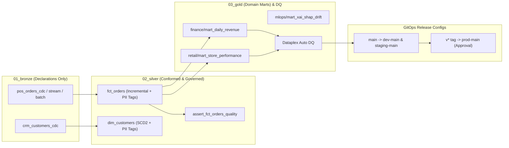

# Enterprise Medallion Operationalization Guide

Run your BigQuery Dataform medallion warehouse from one private repository across `dev`, `staging`, and `prod`.

See [01-architecture-and-sqlx-reference.md](01-architecture-and-sqlx-reference.md) for SQLX contract internals and variable definitions.

## Medallion Pipeline and Promotion Flow

Dataform compiles `01_bronze` declarations, `02_silver` conformed models, and `03_gold` marts before Dataplex Auto DQ runs.



---

## Step 1 — Day 0: Private Repo, Domain CODEOWNERS & GitHub Environments

Never store customer project IDs or Policy Tag paths inside a public fork.

Create a private repository from this template first:

```bash
gh repo create <org>/gcp-data-medallion --private --template choo737/gcp-data-medallion --clone
cd gcp-data-medallion
gh repo view --json isPrivate --jq '.isPrivate'
```

Confirm the final command prints `true`.

Apply these repository controls before merging SQLX models:

1. Update `CODEOWNERS` with your real GitHub team slugs for Silver, Gold Finance, Gold Retail, and quality rules.
2. Protect `main` and require pull requests plus `Medallion Integrity CI` and `Dataform Compilation Dry Run` checks.
3. Create GitHub Environments named `dev`, `staging`, and `prod`.
4. Require human reviewers on the `prod` environment before `prod-main` updates run.
5. Configure Workload Identity Federation (`WIF`) and target variables per environment:

| GitHub Variable | Scope | Purpose |
| :--- | :--- | :--- |
| `GCP_WIF_PROVIDER` | Repo or env | Keyless OIDC Workload Identity Provider resource path |
| `GCP_WIF_SERVICE_ACCOUNT` | Repo or env | Service account compiling Dataform releases |
| `DATAFORM_REPO_PATH` | Repo or env | Target BigQuery Dataform repository resource name |
| `BRONZE_PROJECT` | Environment | Overrides `vars.bronze_project` per environment |
| `SILVER_PROJECT` | Environment | Overrides `defaultDatabase` and `vars.silver_project` |
| `GOLD_PROJECT` | Environment | Overrides `vars.gold_project` per environment |
| `PII_MASKED_POLICY_TAG` | `staging` and `prod` | Masked Policy Tag resource path for email and name |
| `PII_RESTRICTED_POLICY_TAG` | `staging` and `prod` | Restricted Policy Tag resource path for national ID |

---

## Step 2 — Day 1: Connect Bronze Sources (Greenfield Suite or Standalone Brownfield)

Complete [QUESTIONNAIRE.md](../QUESTIONNAIRE.md) before modifying `workflow_settings.yaml` or environment compilation files.

### Option A: Greenfield Suite (gcp-launchpad / gcp-foundation / gcp-data-ingestion)

1. Place gitignored `platform-context.json` from [gcp-launchpad](https://github.com/choo737/gcp-launchpad) in the repository root if available.
2. Copy the three environment templates to gitignored overrides:

```bash
cp envs/dev.compilation.json.example envs/dev.compilation.json
cp envs/staging.compilation.json.example envs/staging.compilation.json
cp envs/prod.compilation.json.example envs/prod.compilation.json
```

3. Fill `bronze_project`, `silver_project`, `gold_project`, and Policy Tag paths in `envs/{dev,staging,prod}.compilation.json`.
4. Set `"allow_untagged_pii": "false"` in `envs/staging.compilation.json` and `envs/prod.compilation.json`.

### Option B: Standalone Brownfield BigQuery

Point `bronze_project` and `bronze_dataset` at existing Fivetran, Airbyte, Debezium, Datastream, or custom ELT BigQuery tables.

1. Update source table `name` and `columns` in `definitions/01_bronze/*.sqlx` to match your Bronze schemas.
2. Keep `type: "declaration"` in every `definitions/01_bronze/` file and never run DDL in Bronze.
3. Set `filter_cdc_deletes` to `"false"` in `workflow_settings.yaml` only if legacy Bronze tables lack `_metadata_deleted`.

---

## Step 3 — Day 1: PR Dry-Run & Tag-Gated Production Release (dev -> staging -> prod)

Every pull request triggers `.github/workflows/ci.yml` and `.github/workflows/dataform-dryrun.yml`.

1. On every PR, `dataform-dryrun.yml` runs `make test` and calls Dataform GA `v1` `compilationResults` over keyless OIDC.
2. When `PII_MASKED_POLICY_TAG` and `PII_RESTRICTED_POLICY_TAG` exist, the dry run forces `allow_untagged_pii: "false"`.
3. Merging to `main` triggers `.github/workflows/dataform-promote.yml` to compile and patch `dev-main` first.
4. Once `dev-main` succeeds, the workflow compiles and patches `staging-main` with `allow_untagged_pii: "false"`.
5. Cut an immutable annotated Git tag to promote production:

```bash
git checkout main && git pull
git tag -a v1.0.0 -m "Release v1.0.0"
git push origin v1.0.0
```

6. Pushing `v1.0.0` pauses for `prod` environment reviewer approval, compiles the immutable tag, and patches `prod-main`.

---

## Step 4 — Day 2: Onboarding New Tables, Domains & Quality Rules

Follow `.agents/skills/add-medallion-model/SKILL.md` and verify this four-part checklist on every new source PR:

1. **Bronze declaration**: Add `definitions/01_bronze/<source>.sqlx` using `type: "declaration"` and explicit column docs.
2. **Silver conformed model**: Add `definitions/02_silver/<entity>.sqlx` aligned with `cdc_helpers.lookbackDays()` in `updatePartitionFilter` and `WHERE`.
   - Attach `policy_tags.piiRestrictedPolicyTag()` or `policy_tags.piiMaskedPolicyTag()` on PII columns.
   - Use `scd_type2.scd2PreviousHashSql(...)` for SCD Type 2 dimensions to strip unchanged CDC heartbeats.
   - Add standalone `definitions/02_silver/assert_<entity>_quality.sqlx` pruned by `cdc_helpers.lookbackDays()` when `requirePartitionFilter: true`.
3. **Gold domain mart**: Add `definitions/03_gold/<domain>/mart_<name>.sqlx`. Fallback `gold_<domain>_project` and `gold_<domain>_dataset` to `gold_project` and `gold_dataset`.
4. **Dataplex Auto DQ**: Add `quality/<entity>_quality.yaml` and register it in `gcp-foundation` `additional_quality_scans` if Terraform manages scans.

Run `make test` locally before opening the pull request.

---

## Step 5 — Day 2: Safe Historical Backfills, Schema Evolution & Assertion Failures

Protect `prod` SLAs and partition filters during historical reloads and schema updates.

### Safe Historical Backfills

- Never run an unguarded `--full-refresh` against large `requirePartitionFilter: true` tables in `prod`.
- Instead, temporarily widen `cdc_lookback_days` in a manual compilation override or run targeted date-windowed backfills.
- Keep `updatePartitionFilter` and the incremental `WHERE` clause equal so late CDC events overwrite cleanly without duplicating keys.

### Schema Evolution

- Add new nullable source columns in `definitions/01_bronze/<source>.sqlx`. Then project them explicitly in `02_silver` and `03_gold`.
- Never write `SELECT *` in `.sqlx` models so upstream schema drift cannot break downstream Gold contracts silently.

### Triaging Assertion and Dataplex Failures

- When Dataform `assert_<entity>_quality.sqlx`, `assert_xai_shap_additivity.sqlx`, or Dataplex Auto DQ fails, halt downstream Gold runs before BI exposure.
- Filter the failing partition slice by `order_date`, fix the ingestion or SQLX bug, and rerun.

---

## Step 6 — Day 2: Scaling to a Multi-Repo Data Mesh

Keep one `gcp-data-medallion` repository with path-scoped `CODEOWNERS` while DAG compile times and PR queues stay fast.

Split a domain into an independent repository only when review load or release cadence requires full isolation:

1. Follow [.agents/skills/split-domain-mesh/SKILL.md](../.agents/skills/split-domain-mesh/SKILL.md) to bootstrap `medallion-<domain>`.
2. Provision a dedicated `google_dataform_repository` for that domain repository inside `gcp-foundation`.
3. Replace upstream Silver `${ref(...)}` dependencies with `definitions/01_upstream/<silver_table>.sqlx` `declaration` blocks.
4. Remove the migrated `definitions/03_gold/<domain>/` folder from `gcp-data-medallion` after `prod` cutover passes.
